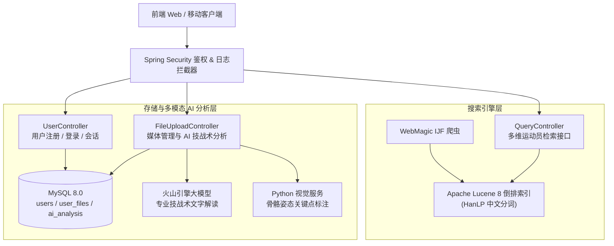

# JudoPro-Backend · 柔道赛事信息检索与技战术智能分析后端系统

[](https://openjdk.org/)
[](https://spring.io/projects/spring-boot)
[](https://lucene.apache.org/)
[](https://www.mysql.com/)
[](https://www.volcengine.com/)

> **大学生创新创业训练计划（大创）项目后端工程**  
> 面向国际柔道联合会（IJF）赛事数据自动化采集、多维倒排检索引擎与“多模态大模型 + 计算机视觉”双引擎技战术智能分析服务。
>
> *声明：本项目所涉及赛事与选手公开数据仅供高校学术研究与创新训练使用，严禁用于商业用途。*

---

## ✨ 核心特性

- 🔍 **多维智能检索引擎**：基于 Apache Lucene 8.11 与 HanLP 分词，支持年龄组别、国际公斤级、大洲/国家、数值区间、多维布尔组合、编辑距离模糊容错与智能混合排序。
- 🤖 **双引擎 AI 技战术分析**：
  - **火山引擎多模态大模型**：输入比赛画面/视频，自动识别投技、寝技攻防态势并生成专业技战术改进报告；
  - **Python 视觉分析微服务**：通过原生二进制流高速传输，检测人体姿态关键点骨骼动作并回传视觉标注。
- 🕷️ **IJF 赛事数据定向采集**：基于 WebMagic 优先级调度队列，自动化抓取全球运动员档案、公斤级与高清比赛抓拍图集。
- 🛡️ **安全认证与多媒体管理**：集成本地/邮箱双模式登录与 BCrypt 密文防护；提供单图、多图与视频全生命周期资产管理。

---

## 🏗️ 系统架构



---

## 🚀 快速上手

### 1. 环境依赖
- **JDK**：Java 11+
- **构建工具**：Maven 3.6+
- **数据库**：MySQL 8.0+（单元测试已内置 H2 内存数据库，本地测试无需启动 MySQL）

### 2. 配置与启动

1. **克隆仓库**：
   ```bash
   git clone https://github.com/ZXJC-niusile/JudoPro-Backend.git
   cd JudoPro-Backend
   ```

2. **环境变量配置（推荐）**：  
   参考根目录 [`.env.example`](.env.example) 注入环境变量，或直接修改 `src/main/resources/application.properties`：
   ```bash
   export DB_URL="jdbc:mysql://localhost:3306/JudoPro?useSSL=false&serverTimezone=UTC"
   export DB_USERNAME="root"
   export DB_PASSWORD="your_password"
   export VOLCENGINE_API_KEY="your_api_key"    # 仅 AI 技战术分析功能需要
   ```

3. **创建数据库**：
   ```sql
   CREATE DATABASE JudoPro DEFAULT CHARACTER SET utf8mb4 COLLATE utf8mb4_unicode_ci;
   ```
   > 应用已开启 `ddl-auto=update`，首次启动会自动初始化数据表（亦可参考 `src/main/resources/schema.sql`）。

4. **编译与运行**：
   - **执行测试**（内置 H2 内存数据库，自包含高速运行）：
     ```bash
     mvn test
     ```
   - **打包并运行**：
     ```bash
     mvn clean package -DskipTests
     java -jar target/judopro-backend-0.1.0-SNAPSHOT.jar
     ```

---

## 📡 接口概览

<details>
<summary><b>👉 点击展开查看完整 RESTful API 列表（30+ 接口）</b></summary>

### 1. 运动员多维检索 (`/query`)

| 方法 | 路径 | 核心参数 | 功能说明 |
| :---: | :--- | :--- | :--- |
| `GET` | `/query/kw` | `kw`, `pageNo`, `pageSize` | 基于 HanLP 分词的关键词分页检索 |
| `GET` | `/query/smart` | `keyword`, `page`, `size` | **智能检索**（精确匹配优先 + 模糊容错补充） |
| `GET` | `/query/fuzzy` | `fuzzyKeyword`, `similarity` | 基于编辑距离相似度阈值的模糊容错检索 |
| `GET` | `/query/combined` | `keyword`, `ageGroup`, `weightClass`, `country` 等 | 多维度布尔组合过滤分页检索 |
| `GET` | `/query/ageGroup` / `/ageRange` | `ageGroup` / `minAge`, `maxAge` | 按柔道年龄组别（CADET/JUNIOR/SENIOR/VETERAN）或年龄区间检索 |
| `GET` | `/query/weightClass` / `/weightRange`| `weightClass` / `minWeight`, `maxWeight` | 按国际标准公斤级（-60kg ~ +100kg）或体重范围检索 |
| `GET` | `/query/continent` / `/country` | `continent` / `country` | 按所属大洲或国家/地区检索 |
| `GET` | `/query/ageGroups` / `/weightClasses` / `/continents` / `/countries` | - | 获取前端筛选器枚举字典数据 |
| `POST`| `/query/rebuild-index` | - | 从本地爬虫归档数据全量重建 Lucene 倒排索引 |

### 2. 用户与认证 (`/api/user`)

| 方法 | 路径 | 参数 / 请求体 | 功能说明 |
| :---: | :--- | :--- | :--- |
| `POST` | `/api/user/register` | JSON: `username`, `email`, `password` | 用户邮箱注册（BCrypt 加密存储） |
| `POST` | `/api/user/login` | JSON: `username`（用户名/邮箱）, `password` | 登录并建立 Session 与 Security 认证上下文 |
| `GET` | `/api/user/me` | Session Cookie | 获取当前登录用户信息 |
| `POST` | `/api/user/logout` | Session Cookie | 注销会话并清理认证上下文 |

### 3. 多媒体与 AI 技战术分析 (`/api/file`)

| 方法 | 路径 | 核心参数 | 功能说明 |
| :---: | :--- | :--- | :--- |
| `POST` | `/api/file/analyze` | `file`, `prompt` (可选) | **核心分析接口**：火山引擎大模型解读 + Python 视觉骨骼标注 |
| `POST` | `/api/file/upload/image` / `video` | `file`, `is_analysis_requested` | 上传图片/视频文件（支持联动 AI 分析） |
| `GET` | `/api/file/list` | `page`, `size`, `type` | 分页获取当前用户的媒体文件及关联 AI 分析报告 |
| `GET` | `/api/file/detail/{fileId}` | `fileId` | 查看指定媒体元数据与完整技战术解读 |
| `GET` | `/api/file/download/{fileId}` | `fileId` | 媒体文件下载（自动累加下载量） |
| `DELETE`| `/api/file/delete/{fileId}` | `fileId` | 删除指定媒体与关联分析记录 |

</details>

---

## 📂 工程结构

```text
JudoPro-Backend
├── pom.xml                     # Maven 构建配置（标准化 artifactId: judopro-backend）
├── .env.example                # 12-Factor 环境变量参考模板
└── src
    ├── main
    │   ├── java/cn/edu/bistu/cs/ir
    │   │   ├── config/         # 权限安全、跨域、大模型与上传路径配置
    │   │   ├── controller/     # 检索(/query)、用户(/api/user)、媒体与AI(/api/file) 控制层
    │   │   ├── crawler/        # WebMagic IJF 柔道数据采集爬虫
    │   │   ├── entity/         # JPA 数据库持久化实体
    │   │   ├── index/          # Lucene 搜索引擎核心与自适应分页查询服务
    │   │   ├── model/          # 柔道领域模型（选手档案、公斤级、年龄组、洲际映射）
    │   │   ├── service/        # 核心业务逻辑（双引擎 AI 分析、检索建造者、用户服务）
    │   │   └── utils/          # 统一响应与分页封装、网络与计算工具
    │   └── resources/          # application.properties, schema.sql, logback-spring.xml
    └── test/                   # H2 内存库测试配置与 68 个全量回归单元测试
```

---

## 👥 团队与致谢

- **团队成员**：[@ZXJC-niusile](https://github.com/ZXJC-niusile) · [@Z-Weather](https://github.com/Z-Weather) · [@ZZHow1024](https://github.com/ZZHow1024) · [@JiaBoYuan-666](https://github.com/JiaBoYuan-666)
- **致谢与声明**：
  - 本项目基于北京信息科技大学《信息检索与搜索引擎》教学示例工程 [`ruoyu-chen/ir_demo`](https://github.com/ruoyu-chen/ir_demo) 及原型探索 [`ZXJC-niusile/ir_ijf`](https://github.com/ZXJC-niusile/ir_ijf) 进行了面向柔道体育领域的全面二次开发与深度重构。
  - 所有爬虫测试与检索数据均源自国际柔道公开档案，仅限高校学术科研与大创竞赛使用。
