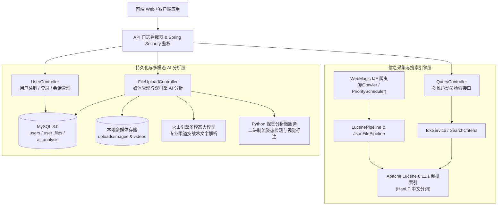

# JudoPro-Backend · 柔道赛事信息检索与技战术智能分析后端系统

> **大学生创新创业训练计划（大创）项目后端工程**
>
> 本项目基于上游《信息检索与搜索引擎》课程基础工程 [`ruoyu-chen/ir_demo`](https://github.com/ruoyu-chen/ir_demo) 与早期原型 [`ZXJC-niusile/ir_ijf`](https://github.com/ZXJC-niusile/ir_ijf) 进行了**全面深度二次开发与业务重构**：从最初单一的课程检索骨架，拓展升级为集 **国际柔道联合会（IJF）赛事数据自动化采集、多维度智能检索引擎、用户安全认证、多媒体资源库及“多模态大模型 + Python 视觉微服务”双引擎柔道技战术 AI 分析** 于一体的完整后端服务系统。
>
> **声明：本项目所涉赛事与运动员公开数据仅用于高校学术研究与创新训练，严禁用于任何商业用途。**

---

## 📖 项目概述

**JudoPro-Backend** 面向柔道运动训练辅助、运动员档案检索与赛事影像复盘场景构建。针对传统体育资料分散、跨维度查询困难以及赛事视频/图像缺乏自动化技战术解读等痛点，团队在上游课程框架基础上完成了以下核心演进：

1. **垂直领域重构**：构建面向 [国际柔道联合会（IJF）](https://www.ijf.org/) 的多优先级定向爬虫与柔道领域数据模型（体重级别、年龄组别、全球国家/大洲映射、聚光灯及赛事图集）。
2. **检索引擎全面升级**：基于 Apache Lucene 与 HanLP 分词器，研发涵盖精确分词、区间过滤、多条件布尔组合、编辑距离模糊纠错及智能优先排序的多维检索服务。
3. **业务全栈化扩展**：引入 MySQL + Spring Data JPA 持久化体系与 Spring Security + Session 双重鉴权机制，补齐完整的用户与个人媒体资产管理能力。
4. **多模态 AI 技战术分析**：打通火山引擎（Volcengine）多模态大模型与 Python 计算机视觉微服务，支持对柔道比赛图片与视频流进行动作识别、可视化标注回传与专业技战术文字复盘。

---

## 🏗 系统架构

---

## 🛠 技术栈

| 类别 | 技术选型 | 版本 / 说明 |
| :--- | :--- | :--- |
| **开发语言** | Java | JDK 11 |
| **核心框架** | Spring Boot | 2.7.5（Web / Validation / DevTools） |
| **安全认证** | Spring Security | BCrypt 密码加密 + HttpSession / SecurityContext 双重认证 |
| **数据持久化** | Spring Data JPA + MySQL | Hibernate ORM（`ddl-auto=update`）+ MySQL Connector 8.0.33 |
| **全文检索引擎** | Apache Lucene | 8.11.1（Core / Queries / QueryParser / Highlighter） |
| **中文分词器** | HanLP | `portable-1.8.3` + `hanlp-lucene-plugin 1.1.7` |
| **数据采集爬虫** | WebMagic | 0.7.6（支持优先级队列调度与多 Pipeline 输出） |
| **HTTP 与多模态通信** | OkHttp3 + Retrofit2 | OkHttp 4.10.0（支持大文件二进制流传输与超时重试） |
| **AI 协同服务** | 火山引擎多模态 API + Python CV 微服务 | 技战术文本生成 + 图像/视频骨骼动作标注 |

---

## ✨ 二次开发核心功能模块

### 1. 🕷️ IJF 柔道数据定向采集引擎 (`crawler` & `model`)
- **三级优先级爬取调度**：基于 WebMagic `PriorityScheduler` 自动遍历国家/地区列表页、运动员索引页与个人详情页（`https://www.ijf.org/judoka`）。
- **结构化档案提取**：自动抽取运动员 ID、姓名、年龄、代表国家/地区及国旗图标、参赛公斤级，并聚合提取 **聚光灯写真（Under The Spotlights）** 与 **赛事抓拍（Photos）** 图集。
- **双通道落盘**：通过 `JsonFilePipeline` 归档原始 JSON 数据，同时经由 `LucenePipeline` 实时写入倒排索引，并支持从本地 `workspace` 一键重建全量索引。

### 2. 🔍 多维度与智能柔道检索引擎 (`index` & `QueryController`)
- **专业柔道领域建模**：
  - **年龄组别（`AgeGroup`）**：`CADET`（青少年组）、`JUNIOR`（青年组）、`SENIOR`（成年组）、`VETERAN`（大师/资深组）。
  - **标准体重级别（`WeightClass`）**：覆盖 `-60kg`、`-66kg`、`-73kg`、`-81kg`、`-90kg`、`-100kg`、`+100kg` 等国际标准级别。
  - **全球地理映射（`Continent` & `CountryContinentMapping`）**：内置六大洲与国家/IOC 代码映射表，支持动态扩展未归类国家集合（`others`）。
- **丰富的检索模式**：支持关键词分页检索、单维度精确筛选、年龄/体重数值区间查询、多条件组合检索（`SearchCriteria` 建造者模式）、基于编辑距离的模糊容错搜索（`fuzzy`）、高级复合检索（`advanced`）以及“精确优先 + 模糊兜底”的智能检索（`smart`）。

### 3. 👤 用户权限与会话管理体系 (`UserController` & `SecurityConfig`)
- 支持邮箱注册、**用户名 / 邮箱双模式登录** 与 BCrypt 强哈希密码校验。
- 采用 `HttpSession` 与 `Spring Security Authentication` 双重会话识别策略，兼顾前后端分离跨域联调与接口级权限控制。

### 4. 🤖 多媒体资产管理与双引擎 AI 技战术分析 (`FileUploadController` & `AIAnalysisService`)
- **全生命周期媒体管理**：支持单图、多图批量及大体积比赛视频上传（默认单文件上限 50MB、单次请求 100MB），提供文件列表分页、详情查看、下载次数统计、热门/最新资源排行及描述维护。
- **双引擎并行/协同 AI 分析工作流**：
  1. **外部多模态大模型（火山引擎）**：内置专业柔道技战术分析提示词（亦支持自定义 Prompt），对上传的比赛画面或视频进行投技/寝技识别、攻防态势评估与改进建议生成；
  2. **Python 视觉分析微服务**：通过二进制流（`/analyze_binary`）或 Base64 接口联动视觉检测服务，自动拉取带关键点/动作框标注的结果图片或视频并回存至后端与 MySQL `ai_analysis` 表。
